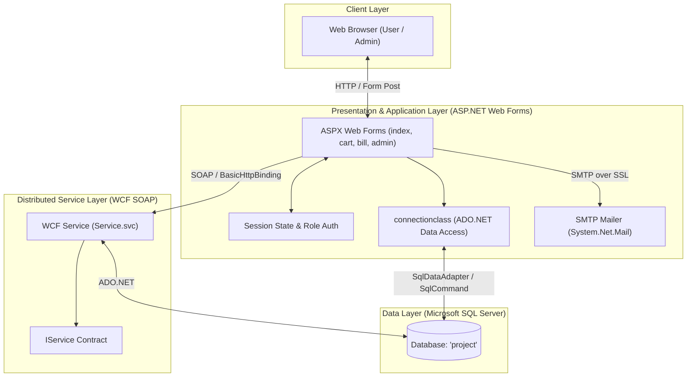

# NOVA STORE 🛒
### *Full-Stack ASP.NET E-Commerce & Order Management System*

[](https://dotnet.microsoft.com/)
[](https://learn.microsoft.com/en-us/dotnet/csharp/)
[](https://dotnet.microsoft.com/apps/aspnet)
[](https://www.microsoft.com/en-us/sql-server/)
[](https://learn.microsoft.com/en-us/dotnet/framework/wcf/)
[](LICENSE)

---

## 📖 Overview

**Nova Store** is a multi-tier e-commerce web application developed using **ASP.NET Web Forms**, **C#**, and **Microsoft SQL Server**, powered by a dedicated **Windows Communication Foundation (WCF)** banking microservice for simulated real-time payment transactions.

The system delivers a complete end-to-end e-commerce lifecycle, featuring customer self-registration, role-based authentication, dynamic product and category catalog navigation, interactive shopping cart management with live subtotal recalculations, order generation, bill invoicing, stock reconciliation, and customer feedback resolution with automated SMTP email notifications.

---

## 🌟 Key Features

### 👤 Customer Experience
* **User Authentication & Session Management**: Secure user registration with comprehensive client and server-side validation (`RequiredFieldValidator`, `RegularExpressionValidator`, `CompareValidator`) and session-driven access control.
* **Catalog Exploration**: Interactive category and product catalog powered by data-bound controls (`DataList`, `GridView`) with dynamic image rendering.
* **Product Details & Stock Validation**: Detailed item views displaying descriptions, prices, promotional offers, and quantity selection throttled dynamically against real-time inventory limits.
* **Dynamic Shopping Cart**: Full shopping cart management allowing customers to adjust item quantities via inline `GridView` editing, trigger dynamic subtotal recalculations, and remove cart items.
* **Checkout & Invoicing**: Automated cart-to-order conversion, order tracking, and itemized invoice/bill generation with total payable calculations.
* **Integrated Banking & Payments**: Simulated core-banking payment gateway connected via WCF to verify account balances, process debits, and trigger automatic stock deduction upon successful payment.
* **Customer Feedback**: Direct feedback submission on purchased products to facilitate after-sales communication.

### 🛠️ Administrative Control Center
* **Unified Master Page Dashboard**: Dedicated administrative interface (`adminhome.aspx`, `adminedits.Master`) providing quick management actions.
* **Category & Product Management**:
  * Create new categories and upload product media directly to the server.
  * Inline catalog moderation using editable `GridView` controls to update descriptions, pricing, offers, stock quantities, and availability statuses.
* **User Moderation**: Real-time customer registry inspection with the ability to activate or suspend/deactivate user accounts.
* **Feedback Review & Email Dispatch**: Review customer feedback and send instant HTML-formatted email responses directly from the dashboard via Gmail SMTP (`System.Net.Mail`).

### 🏦 WCF Payment Microservice
* **Service Contract (`IService`)**: Standalone SOAP service exposing banking endpoints for:
  * `checkbalance(int account_number)`: Retrieves the current available balance for a specified bank account.
  * `returnbalance(int account_number, decimal remaining_balance)`: Executes account debit settlements upon completed transactions.

---

## 🏗️ System Architecture



---

## 🛠️ Technology Stack

| Domain | Technology / Tool | Purpose |
| :--- | :--- | :--- |
| **Framework** | .NET Framework 4.7.2 | Base application runtime |
| **Language** | C# | Server-side business logic and controllers |
| **Web Technology** | ASP.NET Web Forms | Frontend rendering, server controls, and master pages |
| **Database** | Microsoft SQL Server | Relational persistence store |
| **Data Access** | ADO.NET (`SqlConnection`, `SqlCommand`, `SqlDataAdapter`, `SqlDataReader`) | High-performance direct SQL execution |
| **Web Service** | Windows Communication Foundation (WCF) | SOAP-based banking service for balance verification and debits |
| **Email Protocol** | SMTP via `System.Net.Mail.SmtpClient` | Automated feedback replies via Gmail SMTP over SSL |
| **Styling & UI** | HTML5, CSS3, JavaScript, ASP.NET Server Controls | Responsive e-commerce interface |
| **IDE** | Microsoft Visual Studio 2019 / 2022 | Development and debugging environment |

---

## 📂 Project Directory Structure

```plaintext
Nova_store_ASP.NET_project/
│
├── asp_project_1/                     # Main ASP.NET Web Forms Application
│   ├── adminbuttons/                  # Admin dashboard icon assets
│   ├── assets/                        # Static UI assets and images
│   ├── category_images/               # Uploaded category banner images
│   ├── product_images/                # Uploaded product catalog images
│   ├── css/                           # Custom stylesheet files
│   ├── js/                            # Client-side JavaScript scripts
│   ├── Connected Services/            # WCF Service References (ServiceReference1)
│   │
│   ├── admin-register.aspx (.cs)      # Administrator registration module
│   ├── adminedits.Master (.cs)        # Master Page for administrative panels
│   ├── adminhome.aspx (.cs)           # Central administrative control center
│   ├── admin_addcategory.aspx (.cs)   # Category creation & image upload
│   ├── admin_editcategory.aspx (.cs)  # Inline GridView category management
│   ├── admin_addprod.aspx (.cs)       # Product creation with category binding
│   ├── admin_editproduct.aspx (.cs)   # Inline GridView product inventory manager
│   ├── feedbackreply.aspx (.cs)       # Customer feedback moderation inbox
│   ├── sendmail.aspx (.cs)            # SMTP email response composer
│   ├── usermanagement.aspx (.cs)      # Customer account activation/deactivation
│   │
│   ├── index.aspx (.cs)               # Storefront homepage and category browser
│   ├── viewproducts.aspx (.cs)        # Category-filtered product list view
│   ├── viewsingleproduct.aspx (.cs)   # Product detail page & add-to-cart
│   ├── viewcart.aspx (.cs)            # Interactive shopping cart manager
│   ├── viewbill.aspx (.cs)            # Invoice generation & order review
│   ├── paymentpage.aspx (.cs)         # WCF-driven payment and checkout settlement
│   ├── login.aspx (.cs)               # Role-based authentication handler
│   ├── register.aspx (.cs)            # User account registration
│   ├── userfeedback.aspx (.cs)        # Product review and feedback form
│   │
│   ├── connectionclass.cs             # Reusable ADO.NET helper wrapper
│   ├── Web.config                     # Web application configuration & WCF bindings
│   └── asp_project_1.csproj           # Visual Studio Project file
│
├── WCFService_aspproject/             # Standalone WCF Banking Microservice
│   ├── App_Code/
│   │   ├── IService.cs                # Service contract ([ServiceContract], [OperationContract])
│   │   └── Service.cs                 # Implementation of banking transactions
│   ├── Service.svc                    # Service host endpoint
│   ├── Web.config                     # WCF service configuration
│   └── WCFService_aspproject.sln      # Solution file for WCF Service
│
└── README.md                          # Project documentation
```

---

## 🗄️ Database Schema & Entities

The application utilizes a relational Microsoft SQL Server database named `project`. Below is the core entity structure:

| Table Name | Primary Key | Description |
| :--- | :--- | :--- |
| `login` | `reg_id` | Authentication credentials, username, password, and user role (`admin` / `user`). |
| `[user]` | `user_id` | Customer profile (name, email, phone, address, age, pincode, `user_status`). |
| `admin` | `admin_id` | Administrator profile details (name, email). |
| `category` | `category_id` | Product categories (name, description, image path, status). |
| `product` | `product_id` | Store inventory items (name, description, price, stock, image, status, offer, category FK). |
| `cart` | `cart_id` | Active shopping cart items per user (user FK, product FK, quantity, subtotal, status). |
| `[order]` | `order_id` | Confirmed purchases (user FK, product FK, quantity, subtotal, date, status: `'order'`/`'paid'`). |
| `bill` | `bill_id` | Order invoices (bill date, grand total, user FK). |
| `account` | `account_id` | Simulated bank accounts (user FK, account type, account number, balance amount). |
| `feedback` | `feedback_id` | Product feedback tickets (user FK, product FK, date, user message, reply message, status). |

<details>
<summary><b>Click to view complete SQL Database Schema script</b></summary>

```sql
CREATE DATABASE project;
GO

USE project;
GO

-- 1. Login Table (Roles: 'admin', 'user')
CREATE TABLE login (
    reg_id INT PRIMARY KEY,
    username VARCHAR(100) NOT NULL UNIQUE,
    password VARCHAR(100) NOT NULL,
    log_type VARCHAR(20) NOT NULL
);

-- 2. Customer Profile Table
CREATE TABLE [user] (
    user_id INT PRIMARY KEY,
    user_name VARCHAR(100) NOT NULL,
    email VARCHAR(150) NOT NULL,
    phone BIGINT NOT NULL,
    address VARCHAR(255) NOT NULL,
    age INT NOT NULL,
    pincode INT NOT NULL,
    user_status VARCHAR(20) DEFAULT 'active'
);

-- 3. Administrator Profile Table
CREATE TABLE admin (
    admin_id INT PRIMARY KEY,
    admin_name VARCHAR(100) NOT NULL,
    admin_email VARCHAR(150) NOT NULL
);

-- 4. Category Table
CREATE TABLE category (
    category_id INT IDENTITY(1,1) PRIMARY KEY,
    category_name VARCHAR(100) NOT NULL,
    category_image VARCHAR(255),
    category_description VARCHAR(500),
    category_status VARCHAR(20) DEFAULT 'available'
);

-- 5. Product Catalog Table
CREATE TABLE product (
    product_id INT IDENTITY(1,1) PRIMARY KEY,
    product_name VARCHAR(150) NOT NULL,
    product_description VARCHAR(500),
    product_price DECIMAL(18,2) NOT NULL,
    product_stock INT NOT NULL,
    product_image VARCHAR(255),
    product_status VARCHAR(20) DEFAULT 'available',
    offer VARCHAR(100),
    category_id INT FOREIGN KEY REFERENCES category(category_id)
);

-- 6. Shopping Cart Table
CREATE TABLE cart (
    cart_id INT IDENTITY(1,1) PRIMARY KEY,
    user_id INT NOT NULL,
    product_id INT FOREIGN KEY REFERENCES product(product_id),
    quantity INT NOT NULL,
    subtotal DECIMAL(18,2) NOT NULL,
    date DATETIME DEFAULT GETDATE(),
    cart_status INT DEFAULT 1
);

-- 7. Orders Table
CREATE TABLE [order] (
    order_id INT IDENTITY(1,1) PRIMARY KEY,
    user_id INT NOT NULL,
    order_status VARCHAR(20) NOT NULL, -- 'order', 'paid'
    order_date DATETIME DEFAULT GETDATE(),
    product_id INT FOREIGN KEY REFERENCES product(product_id),
    order_quantity INT NOT NULL,
    order_subtotal DECIMAL(18,2) NOT NULL
);

-- 8. Billing Invoices Table
CREATE TABLE bill (
    bill_id INT IDENTITY(1,1) PRIMARY KEY,
    bill_date DATETIME DEFAULT GETDATE(),
    grant_total DECIMAL(18,2) NOT NULL,
    user_id INT NOT NULL
);

-- 9. Banking / Account Table (Accessed by WCF Service)
CREATE TABLE account (
    account_id INT IDENTITY(1,1) PRIMARY KEY,
    user_id INT NOT NULL,
    account_type VARCHAR(50) NOT NULL,
    account_number BIGINT NOT NULL UNIQUE,
    balance_amount DECIMAL(18,2) NOT NULL
);

-- 10. Feedback & Mail Tickets Table
CREATE TABLE feedback (
    feedback_id INT IDENTITY(1,1) PRIMARY KEY,
    user_id INT NOT NULL,
    product_id INT FOREIGN KEY REFERENCES product(product_id),
    feedback_date DATETIME DEFAULT GETDATE(),
    feedback_msg VARCHAR(1000) NOT NULL,
    reply_msg VARCHAR(1000) DEFAULT 'reply_null',
    feedback_status VARCHAR(20) DEFAULT 'active'
);
GO
```
</details>

---

## 🚀 Getting Started & Setup Guide

### 📋 Prerequisites
* **Visual Studio 2019 or 2022** with the **ASP.NET and web development** workload installed.
* **Microsoft SQL Server** (Express or Developer Edition) and **SQL Server Management Studio (SSMS)**.
* **Internet Information Services (IIS) Express** (installed by default with Visual Studio).

---

### ⚙️ Step-by-Step Installation

#### 1. Clone the Repository
```bash
git clone https://github.com/JEESE-JOHN/Nova_store_ASP.NET_project.git
cd Nova_store_ASP.NET_project
```

#### 2. Set Up the Database
1. Open **SQL Server Management Studio (SSMS)** and connect to your local SQL Server instance.
2. Create a new query window and execute the database script provided in the [Database Schema section](#database-schema--entities).
3. Populate initial bank account test records in the `account` table for payment verification testing:
   ```sql
   INSERT INTO account (user_id, account_type, account_number, balance_amount)
   VALUES (1, 'Savings', 1234567890, 50000.00);
   ```

#### 3. Configure Database Connection Strings
Update the SQL Server connection strings in both projects to point to your local database instance:
* In `asp_project_1/connectionclass.cs`:
  ```csharp
  con = new SqlConnection(@"server=YOUR_SERVER_NAME;database=project;integrated security=true");
  ```
* In `WCFService_aspproject/WCFService_aspproject/App_Code/Service.cs`:
  ```csharp
  SqlConnection con = new SqlConnection(@"server=YOUR_SERVER_NAME;database=project;integrated security=true");
  ```

#### 4. Launch the WCF Banking Service
1. Open `WCFService_aspproject/WCFService_aspproject.sln` in Visual Studio.
2. Set `Service.svc` as the Start Page (`Right click Service.svc -> Set As Start Page`).
3. Press `F5` or `Ctrl + F5` to run IIS Express. Note the local port URL (e.g., `http://localhost:59223/Service.svc`).

#### 5. Configure & Run the Web Application
1. Open `asp_project_1/asp_project_1.csproj` in Visual Studio.
2. If your WCF Service port differs from `59223`:
   * Expand **Connected Services** > Right-click `ServiceReference1` > Select **Update Service Reference**.
   * Or update the endpoint address in `Web.config`:
     ```xml
     <endpoint address="http://localhost:YOUR_PORT/Service.svc"
               binding="basicHttpBinding"
               contract="ServiceReference1.IService" />
     ```
3. Set `login.aspx` or `index.aspx` as the Start Page.
4. Press `F5` to build and launch the application in your browser.

---

## 🔄 Core Workflows

### 💳 Checkout & Payment Flow
1. **Browse & Add**: Customer explores items by category, selects quantity, and adds items to cart.
2. **Review Cart**: Customer can edit item quantities or remove products in `viewcart.aspx`.
3. **Generate Invoice**: Cart converts to orders and calculates grand total on `viewbill.aspx`.
4. **WCF Payment Execution**:
   - Customer enters their bank account number on `paymentpage.aspx`.
   - The application invokes the WCF service method `checkbalance(accNo)`.
   - If `Balance >= Grand Total`:
     - Order status transitions from `'order'` to `'paid'`.
     - Inventory stock is deducted: `product_stock = product_stock - order_quantity`.
     - Remaining balance is updated via WCF `returnbalance(accNo, newBalance)`.
   - If balance is insufficient, transaction is halted and an error message is surfaced.

### ✉️ Feedback & Email Response Flow
1. User submits product feedback via `userfeedback.aspx`.
2. Admin views active inquiries in the inbox at `feedbackreply.aspx`.
3. Admin composes an answer on `sendmail.aspx`.
4. Upon clicking send:
   - Feedback ticket status transitions to `'Inactive'` in the database.
   - An HTML email response is dispatched to the customer's email address via Gmail SMTP.

---

## 🔒 Security & Data Integrity Features

* **Server & Client-Side Validation**: ASP.NET validation controls prevent malformed data submissions across all user inputs.
* **Role-Based Access Control**: Login handler redirects users according to their verified role (`admin` to `adminhome.aspx`, `user` to `index.aspx`).
* **Account Status Gating**: Inactive or suspended accounts are detected during login and blocked from accessing storefront sessions.
* **Inventory Consistency**: Stock deduction is linked directly to completed payment confirmations to prevent phantom stock decrements.

---

## 👨‍💻 Author

**Jeese John**
* GitHub: [@JEESE-JOHN](https://github.com/JEESE-JOHN)
* Project Repository: [Nova_store_ASP.NET_project](https://github.com/JEESE-JOHN/Nova_store_ASP.NET_project)

---


